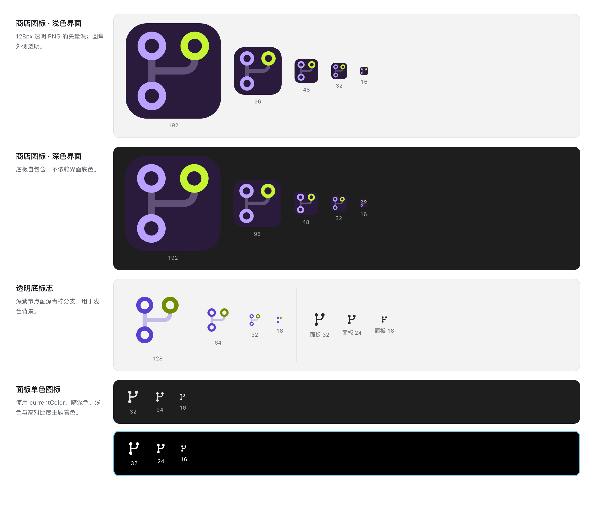

# GitLoom 图标

GitLoom 的标志是一幅分支图：三个环形提交节点中，左上节点与下方节点沿主干相接，右上节点作为分支以圆角连接线接入。主干使用薰衣草色，分支节点用青柠色强调，连接线降低不透明度；深紫圆角底板延续「织序」的沉稳底色。图形为 GitLoom 原创，未使用第三方图标素材。

## 资源

| 文件                                                     | 用途                                                                              |
| -------------------------------------------------------- | --------------------------------------------------------------------------------- |
| [`gitloom.svg`](../../resources/gitloom.svg)             | 512×512 主图标：深紫圆角底板、薰衣草主干节点与青柠分支节点，用于品牌展示与商店导出。 |
| [`gitloom-mark.svg`](../../resources/gitloom-mark.svg)   | 64×64 透明底标志：紫色主干节点配深青柠分支，适用于浅色背景。                      |
| [`git-workbench.svg`](../../resources/git-workbench.svg) | 24×24 面板图标，使用 `currentColor`，以实心节点简化环形标志，适配小尺寸显示。         |
| [`gitloom.png`](../../resources/gitloom.png)             | 从主 SVG 导出的 128×128 带透明通道商店图标；扩展清单的 `icon` 指向此文件。         |

三份 SVG 都由路径与圆组成，没有嵌入位图、外部链接、字体、脚本或滤镜。`width` / `height` 为默认显示尺寸，`viewBox` 支持无损缩放。PNG 是交付副本，设计源文件保留为 SVG。

## 颜色与尺寸

- Plum `#2A1B3D`：主图标圆角底板。
- Lavender `#B8A1FF`：主图标中的主干圆环节点。
- Lime `#C6F432`：主图标右上的分支节点。
- Pale Lavender `#D9CCFF`、30% 不透明度：主图标连接线。
- Violet `#5B3FD1`：透明底标志的主干节点与连接线；在白底上保持足够对比度。
- Deep Lime `#6E8F00`：透明底标志的分支节点；与紫色主干形成明快对比。
- 单色版不固定前景色，由 VS Code 的图标颜色与主题决定；深色、浅色和高对比度界面均使用同一份面板 SVG。

主图标使用 512 单位画布，圆角半径 112，图形由 1024 单位源稿以 0.45 缩放居中。圆环外半径 76.8、孔径半径 38.4，连接带宽 38.4；节点中心分别为 `(140.8, 121.6)`、`(371.2, 121.6)` 与 `(140.8, 390.4)`。

透明底标志使用 64 单位画布，同一图形以 0.05 缩放居中，四周留出约 8 单位空白。面板版沿用标志的分支结构：24 单位画布、2 单位线宽，两个主干节点与右上分支节点改用半径 2.5 的实心圆，分支从主干中部以圆角连接线接出；省略颜色与不透明度变化，保证 16px 下的辨识度。不要直接把彩色主图标缩成面板图标。保留 `resources/git-workbench.svg` 文件名，以兼容现有面板贡献路径。

更新设计时，同步调整主图标与透明底标志，将主 SVG 以 1024×1024 渲染为透明背景 PNG 后降采样到 128×128，并检查透明通道；不要直接放大位图。最后检查彩色版与单色版在 16、24、32px 以及深色、浅色、高对比度背景上的效果。

